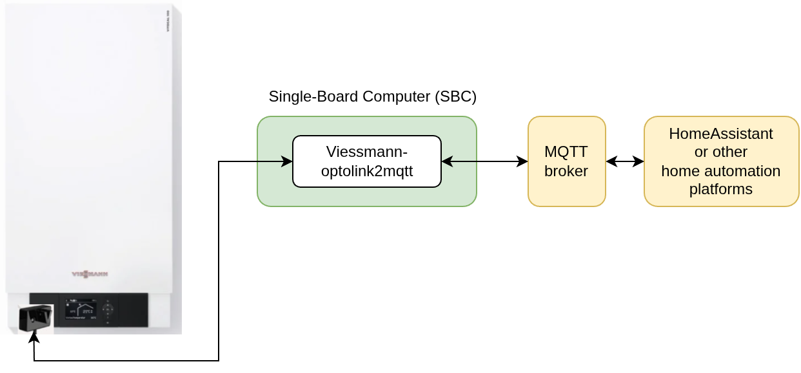
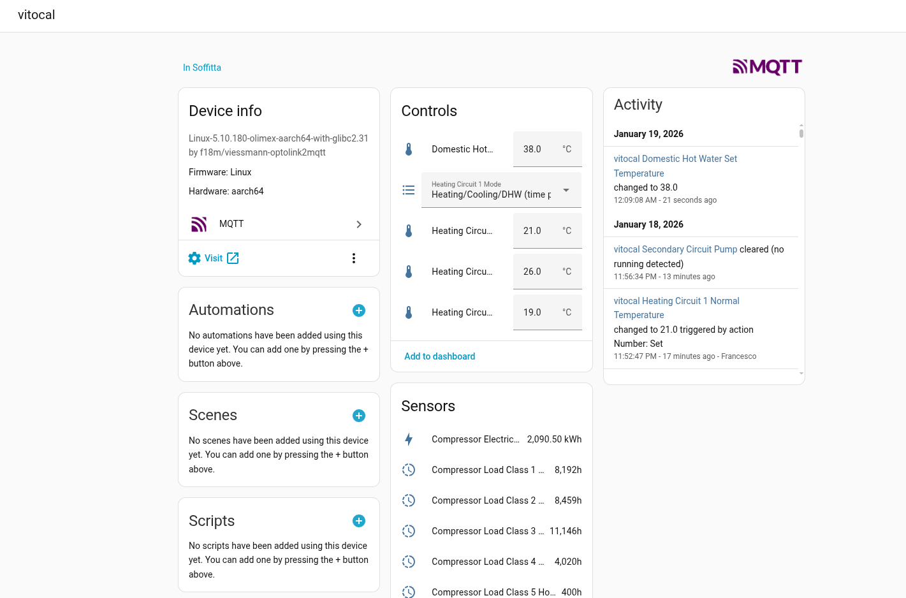
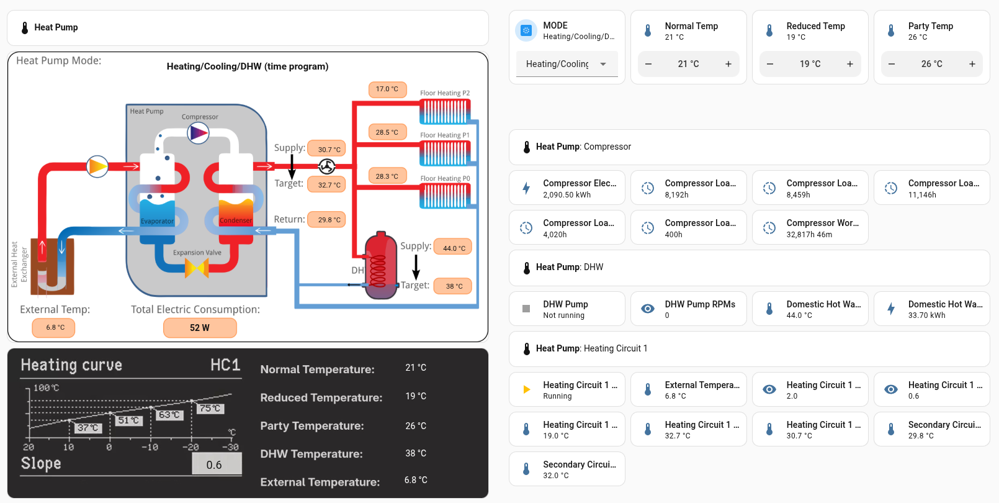

[](https://github.com/f18m/viessmann-optolink2mqtt/releases)
[](https://pypi.org/project/viessmann-optolink2mqtt/)

# viessmann-optolink2mqtt

Open-source [MQTT](https://en.wikipedia.org/wiki/MQTT) bridge for [Viessmann](https://en.wikipedia.org/wiki/Viessmann) heating systems using the Optolink interface.

This project connects a [Viessmann](https://en.wikipedia.org/wiki/Viessmann) device such as a heat pump or gas boiler to a local [MQTT](https://en.wikipedia.org/wiki/MQTT) broker, allowing you to read live telemetry, control writable registers, and integrate everything into Home Assistant or any other MQTT-capable automation stack without sending data to a vendor cloud.

> [!IMPORTANT]
> This project is an independent work and is not associated with, sponsored by, or connected to the Viessmann company in any manner. Viessmann and all related trademarks, product names, and device names are trademarks or registered trademarks of Viessmann and remain the exclusive property of Viessmann.

## Table of contents

- [What is Optolink?](#what-is-optolink)
- [Architecture](#architecture)
- [Hardware requirements](#hardware-requirements)
- [Features](#features)
- [Installation](#installation)
- [Configuration](#configuration)
- [Serial port naming](#serial-port-naming)
- [Home Assistant integration](#home-assistant-integration)
- [Labelling the hardware](#labelling-the-hardware)
- [Roadmap](#roadmap)
- [Related projects](#related-projects)

## 🧩 What is Optolink?

Some Viessmann devices, especially those manufactured before roughly 2014, expose an optical interface called Optolink for communication with third-party tools.

This interface is normally located in the Vitotronic panel and is officially intended for use with the VitoConnect device. But it also allows advanced users to read and write registers on the heating system to collect telemetry such as temperatures and component states, and to change settings such as heating mode or target temperatures.

This project lets you connect to that interface and publish the data to a local MQTT broker, keeping the information on your own network instead of routing it through a vendor cloud.

## 🏗️ Architecture



## 🛠️ Hardware requirements

- A small single-board computer (SBC) capable of running Python and exposing a USB-A port if you use the original Viessmann Optolink USB cable. A typical choice is a [Raspberry Pi](https://www.raspberrypi.com/products/raspberry-pi-5/); the author has also used an [OLinuXino A64](https://www.olimex.com/Products/OLinuXino/A64/A64-OLinuXino/) as a lower-cost alternative.
- An Optolink-to-USB cable. You can either:
  - buy the original Viessmann cable from a specialist vendor such as [Loebbe Shop](https://www.loebbeshop.de/), or
  - build a compatible cable yourself; more details are available from projects such as [MyVitotronicLogger](https://github.com/Ixtalo/MyVitotronicLogger) and the [Optolink Splitter project](https://github.com/philippoo66/optolink-splitter).

## ✨ Features

This project is designed to be:

- reliable and ready to run 24/7, with robust error handling, automatic reconnection to the MQTT broker, and serial-port recovery after transient failures
- easy to configure through a single YAML file for all device parameters and metadata
- capable of both reading values from the heating system and writing writable registers such as heating modes or target temperatures
- Home Assistant friendly, with MQTT discovery support to make entities appear automatically in Home Assistant
- straightforward to install via PyPI or Docker, with simple upgrade paths

Current limitation:

- compatibility with VitoConnect is not implemented; if you need that approach, check out [Optolink Splitter](https://github.com/philippoo66/optolink-splitter) or [Optolink Bridge](https://github.com/kristian/optolink-bridge/).

## 🚀 Installation

This project supports two main setup paths: PyPI and Docker. Both are intended for Linux systems with the USB cable connected to the Optolink interface.

### PyPI package

```sh
python3 -m venv optolink2mqtt-venv
source optolink2mqtt-venv/bin/activate
pip install viessmann-optolink2mqtt

optolink2mqtt --help
```

### Docker

When using Docker, provide the YAML config path and the serial port name in the command line. For example, `/dev/ttyUSB0`:

```sh
docker run -d -v <your config file>:/etc/optolink2mqtt/optolink2mqtt.yaml \
    --device=/dev/ttyUSB0 \
    --hostname $(hostname) \
    --name optolink2mqtt \
    --restart=unless-stopped \
    ghcr.io/f18m/optolink2mqtt:latest

docker logs -f optolink2mqtt
```

The `--restart=unless-stopped` option ensures the container is restarted after a system reboot.

The Docker image supports three architectures: `amd64`, `armv7`, and `arm64`.

If your MQTT broker requires authentication, set `MQTT_BROKER_PASSWORD` to provide the password as an environment variable. Alternatively, mount a Docker secret file and set `MQTT_BROKER_PASSWORD_FILE` to the file path:

```sh
docker run -d -v <your config file>:/etc/optolink2mqtt/optolink2mqtt.yaml \
    -v <path to secret file>:/run/secrets/mqtt_broker_password:ro \
    --env MQTT_BROKER_PASSWORD_FILE=/run/secrets/mqtt_broker_password \
    --device=/dev/ttyUSB0 \
    --hostname $(hostname) \
    --name optolink2mqtt \
    --restart=unless-stopped \
    ghcr.io/f18m/optolink2mqtt:latest
```

The broker username is configured in `mqtt.broker.username` in the YAML file. `MQTT_BROKER_PASSWORD` takes precedence over `MQTT_BROKER_PASSWORD_FILE`, and either environment variable overrides `mqtt.broker.password` in the YAML configuration. A trailing newline in the password file is ignored.

### Docker Compose

If you prefer Docker Compose, use the provided [docker-compose.yml](./docker-compose.yml) file and adapt the serial port name to your system, for example replacing `/dev/ttyUSB0` with the actual port provided by your device.

## ⚙️ Configuration

This software accepts declarative configuration in YAML format. Use [optolink2mqtt.yaml](./optolink2mqtt.yaml) as the reference for the supported syntax and configuration structure.

## How to discover register addresses

This section is still to be written.

## 🔌 Serial port naming

A common issue on some Linux platforms is that a USB serial adapter may be re-enumerated by the kernel after a bus reset, causing the device name to change from `/dev/ttyUSB0` to `/dev/ttyUSB1` or similar. In that case, a config file that references the old device path will stop working.

The recommended solution is to create a stable [udev](https://en.wikipedia.org/wiki/Udev) symlink for the adapter and use that path instead.

1. Use `lsusb` to identify the Viessmann Optolink adapter details. For example:

```sh
Bus 002 Device 006: ID 1a86:7523 QinHeng Electronics CH340 serial converter
```

In this example, `1a86` is the vendor ID and `7523` is the product ID.

2. Create a udev rule:

```sh
sudo nano /etc/udev/rules.d/99_optolink_usb.rules
```

Then add a line like:

```sh
SUBSYSTEM=="tty", ATTRS{idVendor}=="1a86", ATTRS{idProduct}=="7523", SYMLINK+="optolinkUSB"
```

3. Unplug and reconnect the Optolink cable.

4. Use `/dev/optolinkUSB` in [optolink2mqtt.yaml](./optolink2mqtt.yaml) and pass `--device=/dev/optolinkUSB` in Docker commands when needed.

## 🏠 Home Assistant integration

This project makes it easy to expose Viessmann entities to Home Assistant through MQTT discovery.

The `ha_discovery` section of each register in [optolink2mqtt.yaml](./optolink2mqtt.yaml) contains metadata that tells Home Assistant how to create entities automatically.



This makes it possible to build a Home Assistant dashboard that reflects the state of your Viessmann system. For example, the dashboard below was created for a heat pump:



## Labelling the hardware

Your Viessmann device and the SBC used to monitor it may stay in service for many years. To make future maintenance easier, it's a good idea to document what is running where.

A simple approach is to print a QR code pointing to this project and attach it physically to the SBC so that anyone inspecting it can quickly find the relevant documentation.

Here's a QR code generated for that purpose:


## 🗺️ Roadmap

Planned work includes:

- Prometheus support for health statistics such as Optolink errors and network issues

If you are looking for a specific feature, open an [issue](https://github.com/f18m/viessmann-optolink2mqtt/issues).

## 🔗 Related projects

- [Optolink Splitter](https://github.com/philippoo66/optolink-splitter): the original project that inspired this one
- [Optolink Bridge](https://github.com/kristian/optolink-bridge/): an approach based on the Optolink Splitter idea that requires a VitoConnect device and creates a man-in-the-middle bridge
- [openv vcontrold](https://github.com/openv/vcontrold): an older C-based implementation of the VS1 and VS2 protocols; its wiki contains extensive protocol details in German
- [VitoWiFi](https://github.com/bertmelis/VitoWiFi): a C++ implementation of the VS1 (KW) and VS2 (P300) Optolink protocols for Linux and ESP-based systems
- [FloorHeatingController](https://github.com/f18m/floor-heating-controller): firmware for controlling floor-heating valves and replacing physical thermostats with Home Assistant virtual thermostats
